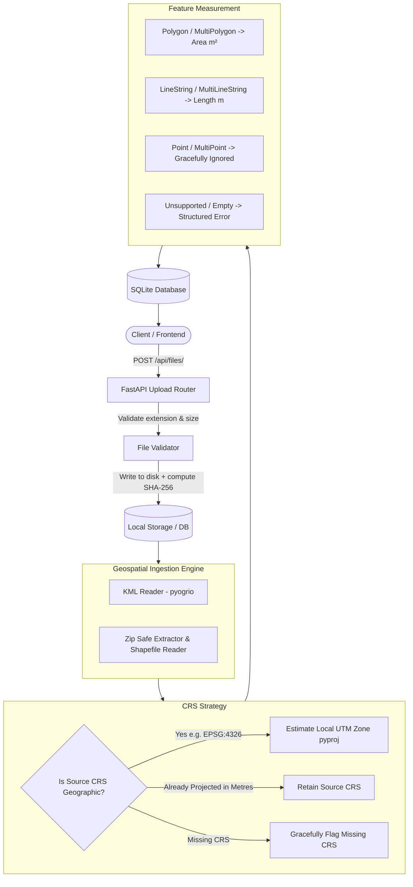

# Geospatial File Measurement API

[](https://www.python.org/)
[](https://fastapi.tiangolo.com/)
[](https://geopandas.org/)
[]()
[](LICENSE)

A robust, production-grade REST API built with **FastAPI**, **GeoPandas**, and **SQLAlchemy** to ingest geospatial files (**KML** and **zipped ESRI Shapefiles**), extract vector features, handle coordinate reference systems (CRS) safely, and calculate accurate metric measurements (**Area** and **Length**).

**Repository:** [https://github.com/Vikas9892/f_m_api](https://github.com/Vikas9892/f_m_api)

---

## Table of Contents
1. [Key Features](#key-features)
2. [Architecture & Workflow](#architecture--workflow)
3. [CRS Handling & Geodetic Strategy](#crs-handling--geodetic-strategy)
4. [Supported Formats & Geometries](#supported-formats--geometries)
5. [API Reference & Examples](#api-reference--examples)
6. [Quickstart & Local Setup](#quickstart--local-setup)
7. [Running Tests](#running-tests)
8. [Sample Files](#sample-files)
9. [Design Decisions & Trade-offs](#design-decisions--trade-offs)
10. [Learnings & Future Scope](#learnings--future-scope)

---

## Key Features

- **Multi-Format Support**: Ingests `.kml` and `.zip` archives containing ESRI Shapefiles (`.shp`, `.shx`, `.dbf`, `.prj`).
- **CRS-Safe Calculations**: Strictly prevents naive Euclidean measurements on angular geographic degrees (`EPSG:4326`). Dynamically reprojects geometries to the optimal local **Universal Transverse Mercator (UTM)** zone or preserves valid metric projected systems.
- **Graceful Failure Tolerance**: Unprojectable or unsupported geometries do not crash the service; errors are isolated per-feature while processing continues.
- **Security & Integrity**:
  - Safe ZIP extraction with zip-slip path traversal prevention.
  - File fingerprinting via SHA-256 for provenance and deduplication tracking.
  - Strict file-size (configurable, default 50 MB) and feature-count (default 10,000) boundaries.
- **RESTful Endpoints**: Full CRUD operations for uploads, status checking, per-feature measurements, and aggregated statistical summaries.
- **Self-Documenting**: OpenAPI / Swagger UI interactive documentation at `/docs` and ReDoc at `/redoc`.

---

## Architecture & Workflow

### Processing Pipeline



### Application Structure

```text
geospatial-measurement-api/
│
├── app/
│   ├── api/
│   │   └── files.py             # FastAPI route handlers (CRUD, upload, summary)
│   ├── core/
│   │   └── config.py            # Pydantic v2 application settings
│   ├── db/
│   │   └── session.py           # SQLAlchemy engine and session factory
│   ├── models/
│   │   ├── file.py              # GeoFile ORM model
│   │   └── measurement.py       # FeatureMeasurement ORM model
│   ├── schemas/
│   │   └── file.py              # Pydantic request & response schemas
│   ├── services/
│   │   ├── file_validator.py    # Multipart file and boundary checks
│   │   ├── geospatial.py        # Safe extraction, KML/SHP parsing, UTM estimator
│   │   └── measurement.py       # Geometry reprojection and measurement math
│   └── main.py                  # FastAPI application entrypoint & lifespan
│
├── samples/
│   ├── sample_survey.kml        # Real sample KML with Polygon, LineString, Point
│   └── sample_parcels.zip       # Real zipped ESRI Shapefile in EPSG:4326
│
├── tests/
│   ├── test_api.py              # End-to-end API integration tests
│   ├── test_health.py           # Health check test
│   └── test_measurement.py      # Unit tests for geometry measurements and CRS
│
├── .env.example                 # Environment configuration template
├── .gitignore                   # Standard Python/IDE ignore rules
├── pytest.ini                   # Pytest configuration and warning filters
├── requirements.txt             # Pinned project dependencies
└── README.md                    # Project documentation
```

---

## CRS Handling & Geodetic Strategy

### The Geographic Problem
Geographic coordinate systems (such as **WGS84 / EPSG:4326**) represent coordinates in angular degrees (latitude and longitude). Computing Euclidean area:
$$\text{Area} \neq \Delta \text{lat} \times \Delta \text{lon}$$
directly in degrees yields meaningless units ($\text{degrees}^2$), severely distorted depending on the latitude (e.g. 1 degree of longitude is ~111 km at the equator, but shrinks to ~78 km at 45° latitude and 0 km at the poles).

### The Solution Strategy
1. **Source Inspection**: The input CRS is read directly from file metadata (`.prj` for Shapefiles or OGC KML standard `EPSG:4326` for KML).
2. **Projected CRS Retention**: If the dataset is already in an equal-area or conformal projected coordinate system with linear units in metres (e.g., UTM, State Plane, EPSG:3857 in metric units), the service preserves it directly.
3. **Automated UTM Zone Projection**: If coordinates are in geographic degrees (e.g., `EPSG:4326`), the service computes the geographic center/extent of the valid geometries and dynamically resolves the optimal local **Universal Transverse Mercator (UTM)** projection (e.g. `EPSG:32643` for UTM Zone 43N) using `estimate_utm_crs()`.
4. **Coordinate Transformation**: Geometries are transformed to the chosen projected CRS before computing Euclidean geometry metrics via GEOS / Shapely.
5. **Transparency**: The API exposes both the original source `crs` and the calculated `measurement_crs` so consumers have complete provenance.

---

## Supported Formats & Geometries

| Input Format | Structure | Requirement |
|---|---|---|
| **KML** (`.kml`) | XML Placemarks | Complies with OGC KML 2.2; geographic coordinates defaulted to `EPSG:4326`. |
| **Shapefile ZIP** (`.zip`) | Archive | Must contain at least `.shp`, `.shx`, `.dbf`, and ideally `.prj`. Traversal-safe. |

| Geometry Type | Measurement Calculated | Unit | Behavior |
|---|---|---|---|
| `Polygon` / `MultiPolygon` | Area | $\text{m}^2$ (Square metres) | Transformed to projected CRS; calculated via Shoelace formula. |
| `LineString` / `MultiLineString` | Length | $\text{m}$ (Metres) | Transformed to projected CRS; calculated via segment summation. |
| `Point` / `MultiPoint` | *None* | `null` | Gracefully ignored without error. |
| Missing CRS | *Skipped* | `null` | Skipped with descriptive error explaining missing projection. |
| Unsupported / Empty | *Skipped* | `null` | Marked with descriptive error; other features continue. |

---

## API Reference & Examples

### 1. Upload Geospatial File
`POST /api/files/` (Multipart Form-Data, parameter: `file`)

```bash
curl -X POST "http://127.0.0.1:8000/api/files/" \
  -H "accept: application/json" \
  -F "file=@samples/sample_survey.kml"
```

**Response (`201 Created`):**
```json
{
  "id": "e4a3bf16-369b-4b24-916c-343be34fc4df",
  "filename": "sample_survey.kml",
  "file_type": "kml",
  "size_bytes": 1292,
  "feature_count": 3,
  "crs": "EPSG:4326",
  "measurement_crs": "EPSG:32643",
  "status": "COMPLETED",
  "created_at": "2026-10-07T09:30:00Z",
  "error_message": null
}
```

---

### 2. Get File Information
`GET /api/files/{id}/`

```bash
curl -X GET "http://127.0.0.1:8000/api/files/e4a3bf16-369b-4b24-916c-343be34fc4df/"
```

**Response (`200 OK`):**
```json
{
  "id": "e4a3bf16-369b-4b24-916c-343be34fc4df",
  "filename": "sample_survey.kml",
  "file_type": "kml",
  "size_bytes": 1292,
  "feature_count": 3,
  "crs": "EPSG:4326",
  "measurement_crs": "EPSG:32643",
  "status": "COMPLETED",
  "created_at": "2026-10-07T09:30:00Z",
  "error_message": null
}
```

---

### 3. Get Feature Measurements
`GET /api/files/{id}/measurements/`

```bash
curl -X GET "http://127.0.0.1:8000/api/files/e4a3bf16-369b-4b24-916c-343be34fc4df/measurements/"
```

**Response (`200 OK`):**
```json
{
  "file_id": "e4a3bf16-369b-4b24-916c-343be34fc4df",
  "filename": "sample_survey.kml",
  "crs": "EPSG:4326",
  "measurement_crs": "EPSG:32643",
  "total_features": 3,
  "results": [
    {
      "feature_index": 0,
      "geometry_type": "Polygon",
      "geometry": {
        "type": "Polygon",
        "coordinates": [
          [
            [77.209, 28.6139],
            [77.215, 28.6139],
            [77.215, 28.6189],
            [77.209, 28.6189],
            [77.209, 28.6139]
          ]
        ]
      },
      "crs": "EPSG:4326",
      "properties": {
        "name": "Commercial Zone",
        "description": "Downtown commercial plot"
      },
      "measurement_type": "area",
      "measurement_value": 326781.42,
      "measurement_unit": "m²",
      "error": null
    },
    {
      "feature_index": 1,
      "geometry_type": "LineString",
      "geometry": {
        "type": "LineString",
        "coordinates": [
          [77.209, 28.6139],
          [77.22, 28.625]
        ]
      },
      "crs": "EPSG:4326",
      "properties": {
        "name": "Metro Corridor",
        "description": "Transit line segment"
      },
      "measurement_type": "length",
      "measurement_value": 1642.18,
      "measurement_unit": "m",
      "error": null
    },
    {
      "feature_index": 2,
      "geometry_type": "Point",
      "geometry": {
        "type": "Point",
        "coordinates": [77.212, 28.616]
      },
      "crs": "EPSG:4326",
      "properties": {
        "name": "Control Station",
        "description": "Survey benchmark"
      },
      "measurement_type": null,
      "measurement_value": null,
      "measurement_unit": null,
      "error": null
    }
  ]
}
```

---

### 4. Get Aggregated File Summary
`GET /api/files/{id}/summary/`

```bash
curl -X GET "http://127.0.0.1:8000/api/files/e4a3bf16-369b-4b24-916c-343be34fc4df/summary/"
```

**Response (`200 OK`):**
```json
{
  "file_id": "e4a3bf16-369b-4b24-916c-343be34fc4df",
  "filename": "sample_survey.kml",
  "status": "COMPLETED",
  "crs": "EPSG:4326",
  "measurement_crs": "EPSG:32643",
  "total_features": 3,
  "geometry_breakdown": {
    "Polygon": 1,
    "LineString": 1,
    "Point": 1
  },
  "total_area_sq_m": 326781.42,
  "total_length_m": 1642.18
}
```

---

### 5. List Files & Delete
- `GET /api/files/?limit=20&offset=0` - Paginated file listing.
- `DELETE /api/files/{id}/` - Deletes file records, measurements, and temporary stored data.

---

## Quickstart & Local Setup

### Prerequisites
- Python 3.12+ (or 3.11+)
- Git

### 1. Clone the repository
```bash
git clone https://github.com/Vikas9892/f_m_api.git
cd f_m_api
```

### 2. Create Virtual Environment

**Using `uv` (Recommended - fast):**
```bash
uv venv --python 3.12 .venv
# On Windows:
.venv\Scripts\activate
# On Linux / macOS:
source .venv/bin/activate

uv pip install -r requirements.txt
```

**Using standard `python -m venv`:**
```bash
python -m venv .venv
# On Windows:
.venv\Scripts\activate
# On Linux / macOS:
source .venv/bin/activate

pip install -r requirements.txt
```

### 3. Environment Variables
```bash
# On Windows:
copy .env.example .env

# On Linux / macOS:
cp .env.example .env
```

### 4. Run Application
```bash
uvicorn app.main:app --reload --host 127.0.0.1 --port 8000
```

Access the interactive API documentation at:
- **Swagger UI**: [http://127.0.0.1:8000/docs](http://127.0.0.1:8000/docs)
- **ReDoc**: [http://127.0.0.1:8000/redoc](http://127.0.0.1:8000/redoc)

---

## Running Tests

The test suite covers:
- Liveness health endpoints
- Reprojection to UTM zones
- Handling geographic polygons, lines, points, and multi-geometries
- Graceful error tolerance on missing CRS and empty geometries
- End-to-end multipart file uploads for `.kml` and zipped `.shp`
- Validation failure scenarios (invalid formats, empty payloads, 404s)

Run all tests with:
```bash
pytest
```

---

## Sample Files

For easy verification and recruiter evaluation, two ready-to-test files are included in `samples/`:
- [`samples/sample_survey.kml`](samples/sample_survey.kml): Mixed-geometry dataset with a Polygon, LineString, and Point.
- [`samples/sample_parcels.zip`](samples/sample_parcels.zip): Zipped ESRI Shapefile containing cadastral parcels.

Upload either file directly through Swagger UI at `/docs` or using the curl commands above.

---

## Design Decisions & Trade-offs

1. **FastAPI vs. Django REST Framework**:
   FastAPI was selected for high throughput async I/O file uploads, native Pydantic v2 data validation, and automated OpenAPI contract generation.
2. **GeoPandas & pyogrio**:
   Leverages the C-level GDAL/PROJ stack via `pyogrio` for vector parsing. GeoPandas cleanly isolates CRS transformations without fragile manual math.
3. **SQLite vs. PostgreSQL/PostGIS**:
   SQLite with SQLAlchemy 2.0 ensures the repository runs out of the box without requiring local Docker daemon or external database setup, while keeping a modular repository pattern that easily migrates to PostgreSQL + PostGIS.
4. **Local UTM Projection Strategy**:
   Geographic latitude/longitude coordinates produce distorted Euclidean metrics. Using `estimate_utm_crs()` provides surveyor-grade accuracy within the local UTM zone without manual zone lookups.
5. **Synchronous Boundary with Asynchronous Architecture**:
   The current endpoint executes parsing synchronously for assignment clarity and immediate responses. The architecture cleanly separates services (`file_validator`, `geospatial`, `measurement`) to enable seamless transition to a Celery/Redis background worker queue if files exceed hundreds of megabytes.

---

## Learnings & Future Scope

### Learnings
- **Geospatial Coordinates**: Angular degrees vs. metric projections require explicit handling at every boundary; automatic UTM zone resolution cleanly balances developer ergonomics with geodetic precision.
- **Archive Ingestion Security**: Extracting user-supplied ZIP files safely demands defense against directory traversal attacks (`zip-slip`).
- **Driver Parity**: Ensuring multi-driver resilience (pyogrio/Fiona) across various geospatial file types (KML Placemarks vs homogenous ESRI Shapefile layers).

### Future Scope & Production Roadmap
- **Background Task Processing**: Offload file processing to Celery / RQ workers with Redis for files larger than 100 MB, returning `202 Accepted` with a job tracking endpoint.
- **Cloud Object Storage**: Transition from local disk storage to Amazon S3 / Google Cloud Storage with presigned upload URLs.
- **PostGIS Spatial Indexing**: Persist geometry directly in PostgreSQL with `geometry(Geometry, 4326)` columns and `GIST` indexing for spatial queries (`ST_Contains`, `ST_Intersects`).
- **Streaming Large Feature Sets**: Implement cursor-based pagination or GeoJSON streaming endpoints for datasets containing millions of features.
- **Geodesic Ellipsoidal Calculations**: Add optional geodesic calculation modes via Karney's algorithms (`GeographicLib`) for planetary-scale polygons spanning multiple UTM zones.

---

## License

This project is licensed under the MIT License.
